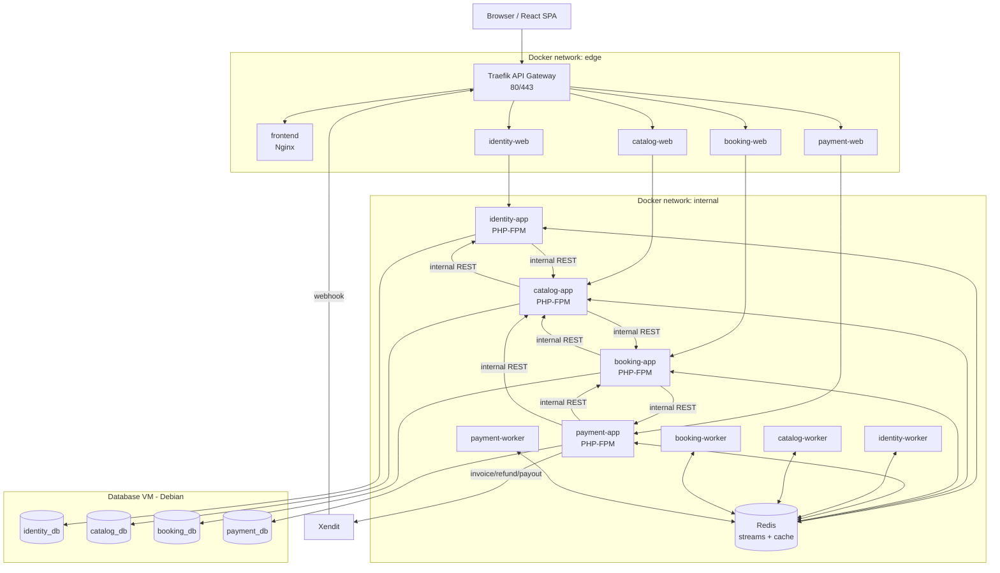

# Target Architecture

## Principles

- One logical database per service, one MySQL user per database, no
  cross-service foreign keys and no cross-service SQL.
- Synchronous internal REST only where a response is required
  (`/internal/*`, shared token + internal Docker network).
- Asynchronous domain events for side effects (notifications, projections,
  booking status after payment, refund status after the refund webhook).
  Transport: Redis Streams with a transactional outbox.
- The API gateway never routes `/internal/*`; those routes only exist on the
  internal network.
- Only Traefik publishes host ports.
- Money is owned by Payment (`ledger_entries` + `barbershop_balances`
  projection). Catalog no longer stores `balance`.
- Booking keeps price/duration/name snapshots so historical bookings remain
  readable if Catalog data changes.
- Dashboard composition lives in Booking; it is the only endpoint that needs
  data from Booking + Payment + Catalog.

## Runtime

- PHP 8.2 FPM (`app` target) + Nginx (`web` target) per service.
- One Dockerfile per service with two targets; Nginx talks to PHP-FPM over the
  internal network.
- Queue/scheduler containers run `php artisan schedule:work` per producing
  service. Schedules: outbox relay (every 10s), event consumer (every minute
  for identity/booking), booking no-show revalidation (every minute).
- Health: PHP-FPM TCP check on app containers, `/up` through Nginx for web
  containers, `redis-cli ping`, frontend `/`.
